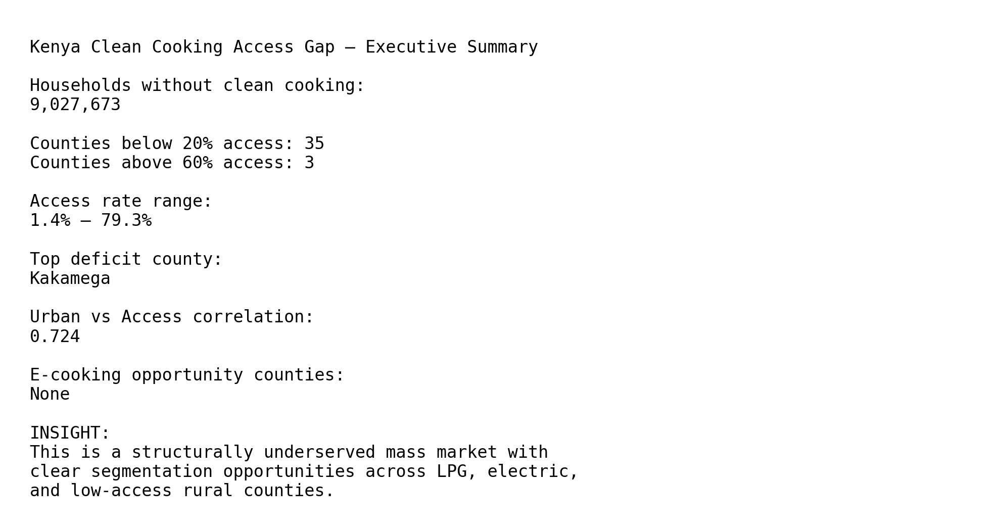
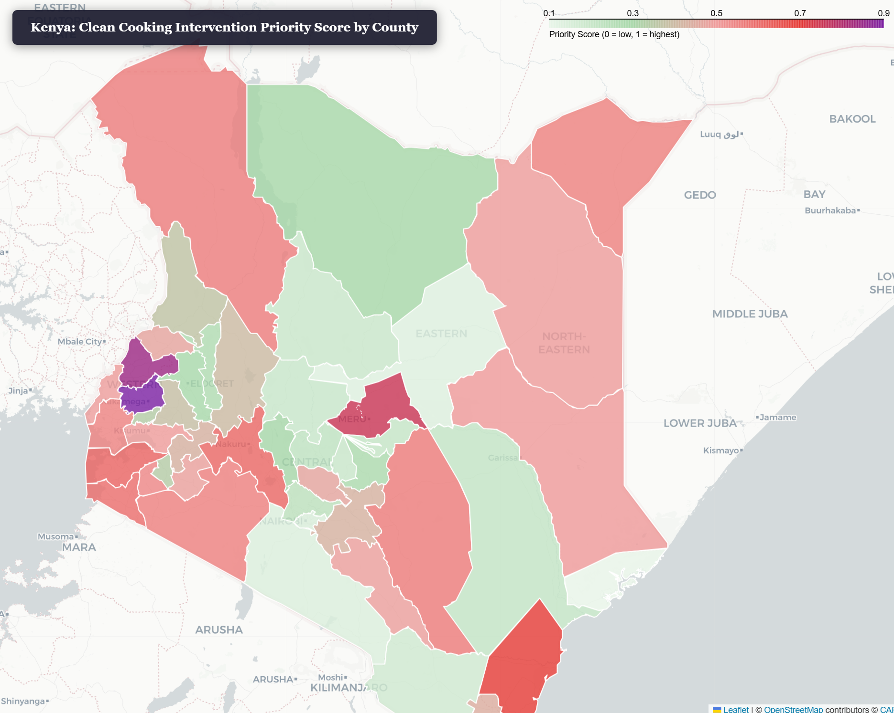
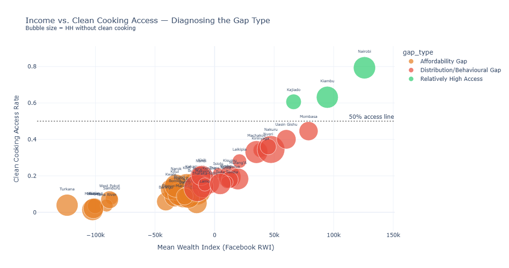

# 🔥 # Kenya Clean Cooking Access Gap Analysis | DHS 2022 Geospatial Market Intelligence
### A County-Level Geospatial Market Opportunity Study


## 🎯 Problem Statement

Kenya’s clean cooking transition is not constrained by national infrastructure — it is constrained by **uneven spatial adoption patterns across counties**.

Despite rising electricity access (77%), only ~31% of households use clean cooking fuels, creating a structural market inefficiency.

This project answers one question:

> Where should governments, investors, and energy companies prioritize intervention to maximize clean cooking adoption impact per unit of capital deployed?

---

## 📌 Strategic Recommendations

### 1. Market Prioritisation Strategy
Focus LPG expansion in high-deficit, high-population counties:
- Kakamega
- Bungoma
- Meru
- Nakuru
- Kilifi

### 2. E-Cooking Market Development
Target 10 identified counties with high electricity penetration but low LPG usage for pilot induction programs.

### 3. Segmented Intervention Strategy
- Low-income rural counties → subsidised LPG rollout
- Mid-income transition counties → hybrid LPG + electric cooking programs
- Urban counties → appliance-driven adoption strategy

### 4. Investment Logic
Shift from national averages to **county-level ROI targeting using deficit-weighted demand**

## 📈 Exploratory Data Analysis Findings

- Urbanisation vs access correlation: **r = 0.724**. Urban counties generally have better access, but 8 relatively urban counties (Garissa, Kwale, Lamu, Mandera, Marsabit, Tana River, Turkana and Wajir) still have low access
- 10 counties identified as **e-cooking opportunity markets**
- Moderate negative relationship between the share of female-headed households and access (r = -0.379)
- Wealth is the strongest correlate of access (r = 0.878), with a non-linear, threshold-like adoption pattern

---

## 📊 Impact Potential

If interventions are targeted using this framework:

- Capital efficiency improves by prioritising high-deficit counties
- Carbon project additionality increases through precise targeting
- Distribution costs reduce via cluster-based rollout strategy
- Adoption rates improve through segmentation-based interventions


## 📌 Executive Summary Dashboard



## ✅ Data Status

This project now uses **real Kenya DHS 2022 household survey data** (licensed access via DHS Program) combined with public geospatial and policy datasets.

To comply with DHS redistribution terms:

- Raw household microdata is **not stored in this repository**
- Only aggregated county-level outputs are published
- All charts, maps, rankings, and findings are reproducible using the notebooks

The pipeline ingests:

- Kenya DHS Household Recode (.dta)
- Kenya county shapefiles
- Public energy access benchmarks
- Supporting socioeconomic datasets

---

## 💼 Business Context & Investment Relevance

- **~9.1 million Kenyan households** still rely on charcoal or firewood for cooking
- The Government of Kenya has set a target of **100% clean cooking access by 2028** — four years away
- Access gaps are not uniform: **county-level disparities are large** and drive where interventions deliver the most value
- Carbon project developers, LPG distributors, and impact investors need granular demand intelligence to deploy capital efficiently

---

## 🗺️ What This Project Produces

| Output | Description |
|--------|-------------|
| `outputs/maps/01_access_rate_choropleth.html` | Interactive county-level map of clean cooking access rates |
| `outputs/maps/02_deficit_map.html` | Population-weighted map of households without clean cooking |
| `outputs/maps/03_priority_map.html` | Composite intervention priority score by county |
| `outputs/charts/priority_matrix.html` | High-population × low-access opportunity quadrant chart |
| `outputs/charts/county_clusters.html` | K-means market archetype segmentation |
| `outputs/tables/kenya_county_priority_summary.csv` | All 47 counties ranked by priority score |

---

## 📂 Project Structure

```
kenya-clean-cooking-gap/
│
├── data/                              # ← excluded from Git (see .gitignore)
│   ├── raw/                           # Original downloaded datasets
│   ├── processed/                     # Cleaned, merged county-level dataset
│   └── shapefiles/                    # Kenya county boundaries (GADM)
│
├── notebooks/
│   ├── 01_data_collection.ipynb       # Download & inspect all source data
│   ├── 02_data_processing.ipynb       # Clean, merge, engineer features
│   ├── 03_exploratory_analysis.ipynb  # EDA — distributions, correlations
│   ├── 04_geospatial_maps.ipynb       # Choropleth & deficit maps (Folium)
│   └── 05_priority_analysis.ipynb     # Priority matrix, clustering, CSV export
│
├── outputs/
│   ├── maps/                          # HTML interactive maps
│   ├── charts/                        # Plotly chart exports
│   └── tables/                        # CSV summaries
│
├── docs/
│   └── data_dictionary.md             # Variable definitions and source citations
│
├── .gitignore
├── requirements.txt
└── README.md
```

---

## 📊 Data Sources

All datasets are **free and publicly available**.

| Dataset | Source | Variables Used |
|---------|--------|----------------|
| Kenya DHS 2022 | [DHS Program](https://dhsprogram.com) | Cooking fuel type, income, gender of HH head by county |
| Kenya National Cooking Transition Strategy 2024 | [energy.go.ke](https://www.energy.go.ke) | County prevalence vs. deficit table |
| World Bank SDG-7 Time Series | [data.worldbank.org](https://data.worldbank.org/indicator/EG.CFT.ACCS.ZS?locations=KE) | National clean cooking access % (2000–2021) |
| Kenya County Shapefiles | [GADM](https://gadm.org/download_country.html) | County geometries |
| Facebook Relative Wealth Index | [data.humdata.org](https://data.humdata.org/dataset/relative-wealth-index) | Sub-national wealth proxy |

> **DHS access note:** Registration is free at dhsprogram.com (approval typically 1–2 days). Request the Kenya 2022 KDHS Household Recode (HR) file. The key variable is `HV226` (type of cooking fuel). Save as `data/raw/KEHR8AFL.csv`.

---

## 🔬 Analytical Framework

### 1. Access Rate Mapping
Clean cooking access rate per county, derived from DHS household fuel data and benchmarked against Kenya's 2028 universal access target.

### 2. Population-Weighted Deficit
```
Deficit (households) = Total HHs × (1 − Clean Cooking Access Rate)
```
Surfaces counties where the *absolute* number of underserved households is largest — the metric that matters for market sizing, not just percentage.

### 3. Priority Matrix (4-Quadrant)
Counties plotted on two axes — total households (market size) vs. access gap — to identify the high-population, high-gap zones that represent the greatest intervention opportunity.

### 4. Affordability vs. Distribution Gap
Overlaying the Facebook Relative Wealth Index against access rates diagnoses whether a county's gap is primarily an **affordability problem** or a **supply/distribution problem** — the two require different interventions.

### 5. K-Means Market Segmentation
Counties clustered into four market archetypes by access rate, urbanisation, population, and wealth — producing actionable segments for distributors and carbon project developers.

---

## 🧪 Hypotheses Tested

1. **Urban ≠ clean** — High urbanisation does not guarantee clean cooking access
2. **The LPG–electricity split** — Counties with high electricity but low LPG penetration signal the e-cooking opportunity
3. **Income threshold** — There is a wealth level above which clean cooking adoption accelerates sharply
4. **Gender disaggregation** — Female-headed households show different fuel choice patterns at the same income level

---


## 📸 Sample Outputs

### County Priority Map


### Opportunity Quadrant


---

## 🚀 Getting Started

```bash
# Clone the repo
git clone https://github.com/EricNjiraini/kenya-clean-cooking-gap.git
cd kenya-clean-cooking-gap

# Install dependencies
pip install -r requirements.txt

# Launch notebooks
jupyter lab
```

Run notebooks in order: `01 → 02 → 03 → 04 → 05`. Notebook 01 has step-by-step instructions for each dataset download.

---

## 🔭 Phase 2 Preview: Sub-Saharan Africa

This Kenya analysis is the methodological foundation for a broader SSA-wide study that will:
- Apply the same framework across 54 countries using harmonised DHS data
- Integrate OnStove net-benefit rasters (KTH / Nature Sustainability, 2023)
- Rank countries by investment gap: access deficit vs. capital deployed
- Cluster countries into market archetypes for strategic entry analysis

---

## 📖 References

- Kenya National Cooking Transition Strategy, 2024–2028 — Ministry of Energy and Petroleum
- Khavari et al. (2023). "A geospatial approach to understanding clean cooking challenges in sub-Saharan Africa." *Nature Sustainability*
- IEA (2024). *Universal Access to Clean Cooking in Africa*
- DHS Program (2022). *Kenya Demographic and Health Survey*
- WRI (2024). "Leveraging Energy Access Explorer to Advance Kenya's Clean Cooking Agenda"

---

## 👤 Author

**Eric Njiraini** | Data Analytics Professional, Nairobi
*Specialising in business intelligence, Data Analytics, and geospatial analytics in Sub-Saharan Africa*

[](https://github.com/EricNjiraini)

---

*Part of a portfolio series on data analytics in the clean cooking and energy access sector.*
